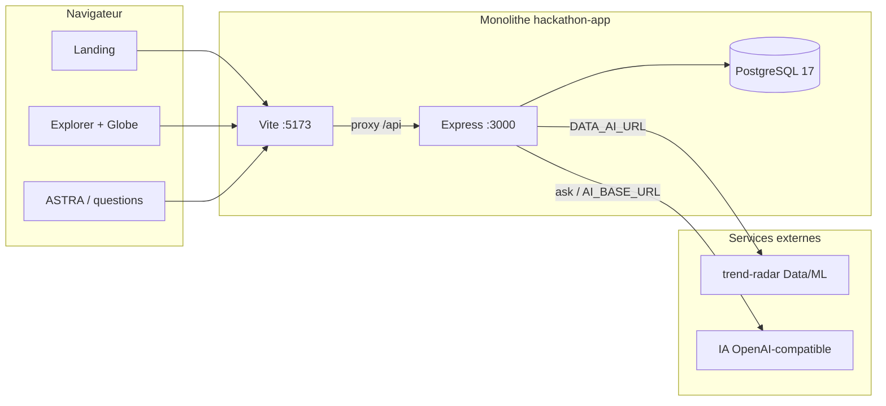
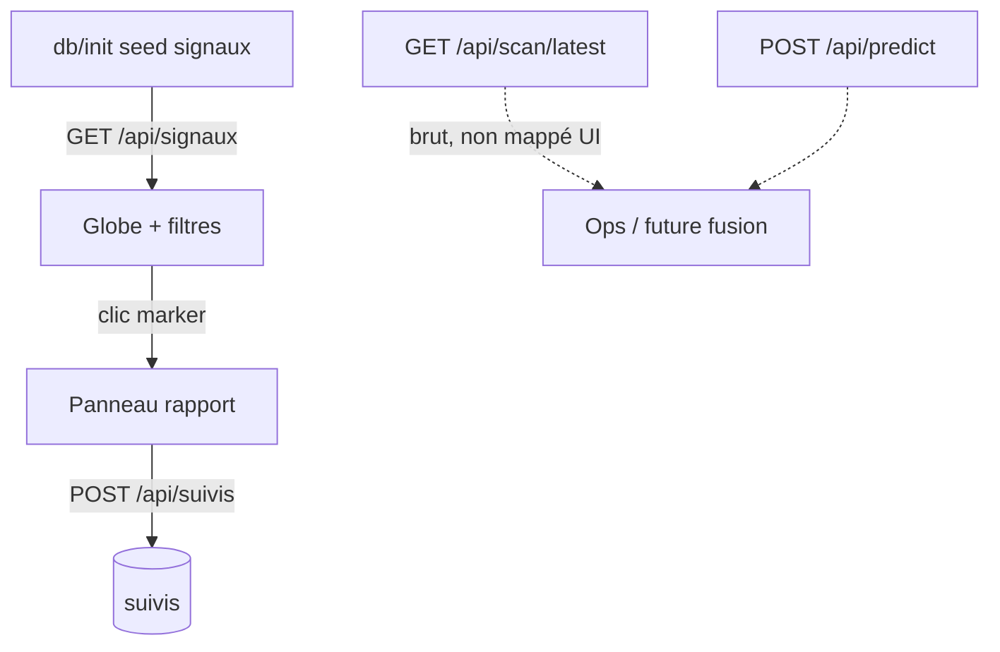
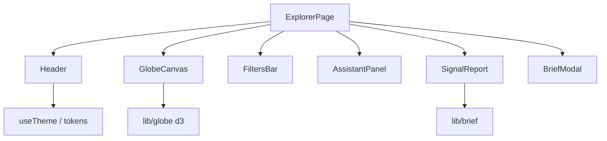

# FORECASTRO / TrendRadar — récapitulatif projet

Document de synthèse du monolithe [`hackathon-app`](https://github.com/MYCHA-Hetic-Hackathon-Givaudan-2026/hackathon-app) (HETIC × Givaudan 2026).  
Complète le [`README.md`](../README.md) (prise en main) et les [`ADR`](./adr/) (décisions). Le backlog vivant est dans [`TODO.md`](./TODO.md).

**État documenté** : `develop` + PRs ouvertes au moment de la rédaction (#29 Data, #31 UI Forecastro, #26 veille). Mettre à jour ce fichier quand elles fusionnent.

---

## 1. Vision et besoin

### Besoin métier

Le **manager CMI** (Consumer Market Insights) chez Givaudan doit répondre vite à :

> _Ce sujet commence-t-il à plaire ? À quel niveau ? Est-ce un buzz qui va retomber, ou une tendance durable qui s’ancrera dans le quotidien ?_

Avec cette lecture, il peut :

1. **Anticiper** les demandes B2B d’une zone ;
2. **Lancer tôt** la réflexion avec les créateurs d’arômes / parfums sur la faisabilité ;
3. **Orienter** les commerciaux vers les sujets qui vont s’installer ;
4. **Suivre** les signaux pertinents et recevoir une veille d’évolution.

Les trois premiers usages sont **trois lectures du même signal**, pas trois apps.

### Produit livré (démo)

**FORECASTRO** (marque UI / maquette) · **TrendRadar** (nom produit / API / seed SQL) est un explorateur de **signaux** sur un globe :

- Landing → choisir « Nouvelle recherche » (ASTRA) ou « Explorer le globe » ;
- Globe 3D filtrable (profil durable/buzz, confiance, fenêtre temporelle) ;
- Panneau rapport par signal (ce qui plaît, matières, veille, dates) ;
- Suivis persistés en base ;
- Assistant ASTRA (questions IA via le monolithe) ;
- Brief métier généré côté client (démo, PR #31).

---

## 2. Choix techniques

### Stack (ADR 0001 — acceptée)

| Couche           | Choix                                       | Notes                              |
| ---------------- | ------------------------------------------- | ---------------------------------- |
| Runtime          | Node 24 + TypeScript                        | Image CI `node:24-trixie`          |
| API              | Express (`api/src/index.ts`)                | Amorce cours, pas Nest/Fastify     |
| Front            | Vite + React (`web/`)                       | Proxy `/api` → `:3000`             |
| Base             | PostgreSQL 17 (`db/init/`)                  | ADR 0007 acceptée                  |
| IA chat          | Compatible OpenAI via `ask()` + `AI_*` env  | Ollama en compose ; ngrok possible |
| Data / ML        | Service externe **trend-radar**             | Contrat `docs/data/openapi.json`   |
| Contrat HTTP     | `openapi.yaml` OpenAPI 3.1 (contract-first) | ADR 0006 acceptée                  |
| Poste de travail | Dev container + `compose.yaml`              | `dev` + `db` + `ollama`            |

### Front produit

| Sujet         | Choix                                                                |
| ------------- | -------------------------------------------------------------------- |
| Navigation    | Mini-router maison (`path` / `popstate`), pas React Router           |
| Globe         | Canvas + d3-geo (projection orthographique, hit-test markers)        |
| Charte        | Tokens CSS Forecastro (Sora / Inter, navy–argile–bleu, `data-theme`) |
| Thème         | Clair / sombre persisté (`localStorage`) — PR #31                    |
| Données globe | Seed SQL `GET /api/signaux` (IDs stables pour suivis)                |

### Gouvernance (ADR 0002–0005 — acceptées)

GitFlow léger : branche `<type>/<n°>-<slug>` → PR vers `develop` (squash) → `main` (merge commit). Pas de push direct. CI `qualite` : `lint` + `format:check` + `build`.

---

## 3. Conformité et écarts au plan initial

Plans de référence (hors git) : `.scratch/plan-mvp.md`, `.scratch/plan-technique.md`, `.scratch/mvp-trendradar.md`.

### Conforme / tenu

| Intention initiale               | Réalité actuelle                                 |
| -------------------------------- | ------------------------------------------------ |
| Monolithe Express + Vite + PG 17 | Oui                                              |
| Contract-first `openapi.yaml`    | Oui (toute route monolithe y passe)              |
| Proxy Data via `DATA_AI_URL`     | Oui ; **réaligné** sur trend-radar (PR #29)      |
| Distinction buzz / durable       | Oui (`profil` sur le seed ; Data expose `label`) |
| Suivis persistés                 | Oui (`/api/suivis`, table `suivis`)              |
| Veille datée (append-only)       | En cours PR #26                                  |
| Secrets hors dépôt               | Oui (`api/.env`)                                 |
| Dev container unique             | Oui                                              |

### Écarts assumés (évolution produit)

| Plan MVP d’origine                        | Écart                                                                   | Pourquoi                                                                                             |
| ----------------------------------------- | ----------------------------------------------------------------------- | ---------------------------------------------------------------------------------------------------- |
| Accueil = liste région + sujets Data      | **Globe interactif** + landing marketing                                | Maquette TrendRadar / Forecastro ; le plan listait la carte « hors MVP », puis le mockup l’a imposée |
| `POST /api/tendances` (dummy 0.1)         | Remplacé par `/api/scan/latest`, `/api/predict`, … (PR #29)             | L’API Data réelle n’a jamais exposé `/tendances`                                                     |
| Suivis = `{ sujet, region }`              | Suivis = **signal_id** (FK seed)                                        | IDs stables + panneau rapport                                                                        |
| Profil attendu du contrat Data avant UI   | Profil d’abord sur **seed démo**, Data en parallèle                     | Démo globe sans bloquer sur Data                                                                     |
| Pas inventer de champs absents de Data    | Seed complet (geo, matières, veille…) ; Data a des champs `demo_fictif` | Documenté dans l’alignement Data ; pas de faux mapping `growth_since_t0` → `croissance_pct`          |
| Formulaire questions = hors écran manager | Conservé derrière **ASTRA**                                             | Démo IA + atelier cours                                                                              |
| Marque TrendRadar                         | UI **FORECASTRO** (PR #31)                                              | Maquette `.scratch/forecastro-front`                                                                 |

### ADR techniques (acceptées le 2026-11-12)

0001 (stack), 0006 (OpenAPI contract-first), 0007 (PostgreSQL 17) : confirmées au regard de la stack en place. On ne les réécrit pas : nouvel ADR si changement de décision.

---

## 4. Hors scope de l’app actuelle

Explicitement **hors** du monolithe tel qu’il est :

- Catalogue produits, CRM commercial, outil de formulation créateurs ;
- Auth / multi-utilisateurs / droits par manager ;
- Ingestion temps réel des sources (scraping, social listening) — côté équipe Data ;
- Adaptateur automatique `ScanRow` → `Signal` branché sur le globe (décision spike : proxies bruts + seed séparé) ;
- Brief métier branché sur un LLM / Data (aujourd’hui générateur client démo) ;
- Carte serveur / tuiles carto (tout est canvas local) ;
- App mobile native ;
- Hébergement production multi-région, observabilité avancée ;
- Remplacement Express/Vite (possible plus tard via nouvel ADR) ;
- Commit des maquettes `.scratch/` (ignoré / local).

---

## 5. Architecture (schémas)

### Vue d’ensemble

### Flux données « signal »

### Découpage front Explorer (cible PR #31)

---

## 6. Lexique

Termes **spécifiques** ou **récurrents** dans ce dépôt :

| Terme              | Sens ici                                                                         |
| ------------------ | -------------------------------------------------------------------------------- |
| **CMI**            | Consumer Market Insights — persona manager Givaudan                              |
| **Signal**         | Sujet émergent (nom, profil, geo, confiance…) exposé au globe via `/api/signaux` |
| **Profil**         | `durable` (tendance qui s’installe) ou `buzz` (pic probablement transitoire)     |
| **Confiance**      | Score 50–100 (`confiance_pct`) ; taille des markers                              |
| **ScanRow**        | Ligne renvoyée par Data `/scan/latest` (contrat trend-radar)                     |
| **trend-radar**    | Service Data/ML amont (FastAPI), dépôt / API distincts                           |
| **Proxy Data**     | Routes monolithe qui relaient `DATA_AI_URL` sans recalculer les scores           |
| **Graine / seed**  | Jeu SQL démo (`db/init/003-signaux.sql`) pour le globe                           |
| **Suivi**          | Signal épinglé par le manager (`/api/suivis`)                                    |
| **Veille**         | Remontée textuelle datée sur un suivi (append-only)                              |
| **ASTRA**          | Assistant conversationnel de l’Explorer (questions → IA)                         |
| **Brief**          | Synthèse métier exportable (démo client) à partir d’un signal                    |
| **FORECASTRO**     | Marque / charte UI de la maquette intégrée                                       |
| **TrendRadar**     | Nom produit / API / seed historiques                                             |
| **Contract-first** | Décrire la route dans `openapi.yaml` avant (ou avec) le code                     |
| **Monolithe**      | Un dépôt, workspaces `api/` + `web/`, un lockfile                                |
| **ADR**            | Architecture Decision Record dans `docs/adr/`                                    |
| **demo_fictif**    | Champs Data présents seulement en mode démo (geo, matières…)                     |
| **ngrok**          | Tunnel pour joindre une IA / Data hors réseau du container                       |
| **Hit-test**       | Détection du marker sous le curseur sur le canvas globe                          |
| `**data-theme**`   | Attribut HTML pilotant clair/sombre via tokens CSS                               |

---

## 7. Cartographie des livrables récents

| Sujet           | Branche / PR                                                                                       | Contenu                                                                 |
| --------------- | -------------------------------------------------------------------------------------------------- | ----------------------------------------------------------------------- |
| Alignement Data | [#29](https://github.com/MYCHA-Hetic-Hackathon-Givaudan-2026/hackathon-app/pull/29) `spike/27-…`   | Proxies scan/predict, retrait `/tendances`, doc d’écarts Signal↔ScanRow |
| UI Forecastro   | [#31](https://github.com/MYCHA-Hetic-Hackathon-Givaudan-2026/hackathon-app/pull/31) `feature/30-…` | Tokens, thème, shell, zoom/hover globe, rapport + brief                 |
| Veille + agent  | [#26](https://github.com/MYCHA-Hetic-Hackathon-Givaudan-2026/hackathon-app/pull/26)                | Append-only veille / agent (en revue)                                   |

Commits UI (#31), pour revue fichier par fichier :

1. Tokens + thème — `tokens.css`, `theme.ts`, `useTheme.ts`, `index.html`, `main.tsx`
2. Shell + landing — Header, ASTRA, filtres, CSS explorer/landing
3. Globe UX — `GlobeCanvas`, `lib/globe/*`
4. Rapport + brief — `SignalReport`, `BriefModal`, `brief.ts`, `ExplorerPage`

---

## 8. Recommandations

1. **Fusionner #29 avant de brancher le globe sur Data** — sinon le front reste sur un contrat `/tendances` obsolète côté `develop`.
2. **Ticket dédié « adaptateur ScanRow → Signal »** avec règles explicites (pas de faux `croissance_pct`) + filtre `exclu_raison` ; jusqu’alors garder le seed pour les IDs de suivis.
3. **Brancher le brief** sur `ask()` ou sur un endpoint Data une fois le prompt métier validé ; retirer le générateur purement client.
4. **Auth minimale** (même un pseudo + header) avant toute démo multi-managers : les suivis sont aujourd’hui globaux.
5. **Recette manuelle checklist** dans chaque PR UI (thème clair/sombre, zoom, hover, brief, logo → `/`) — la CI ne couvre pas le canvas.
6. **Ne pas committer `.scratch/`** ; y garder maquettes et notes de spike ; promouvoir dans `docs/` seulement ce qui doit vivre avec le produit (comme ce fichier).
7. **Mettre à jour `openapi.yaml`** (et nouvel ADR seulement si on quitte le contract-first) quand `/tendances` disparaît définitivement de `develop`.
8. **Performance globe** : profiler le redraw au zoom max ×8 sur machines faibles ; éventuel throttle du hover.
9. **Lien produit ↔ Data** : une page unique « contrat vivant » (déjà amorcée par `docs/data/`) relue à chaque démo jury.

---

## 9. Liens utiles

| Ressource         | Chemin                                                        |
| ----------------- | ------------------------------------------------------------- |
| Prise en main     | [`README.md`](../README.md)                                   |
| Règles assistants | [`AGENTS.md`](../AGENTS.md)                                   |
| Contrat monolithe | [`openapi.yaml`](../openapi.yaml)                             |
| Contrat Data      | [`docs/data/openapi.json`](./data/openapi.json)               |
| ADR               | [`docs/adr/`](./adr/)                                         |
| Backlog features  | [`docs/TODO.md`](./TODO.md)                                   |
| Template PR       | [`docs/PULL_REQUEST_TEMPLATE.md`](./PULL_REQUEST_TEMPLATE.md) |
